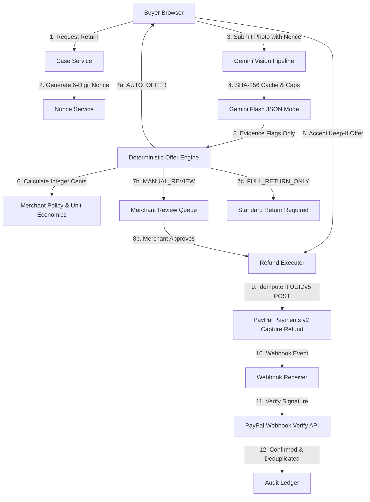

# ReturnGate

Merchant-controlled, pre-label, capped keep-it partial refund workflow with AI-assisted evidence triage, built on PayPal Orders v2 and Payments v2.

May reduce avoidable return costs (hypothesis).

---

## 1. Claims Guardrails and Scope

ReturnGate is a merchant-controlled pre-label workflow.

- Allowed claims: "merchant-controlled", "pre-label", "capped keep-it partial refund", "AI-assisted evidence triage", "may reduce avoidable return costs (hypothesis)".
- Non-goals: ReturnGate does not detect fraud, does not prevent chargebacks or disputes, does not prove item condition or authenticity, and is not an autonomous refund agent.
- Evidence triage only: The single-use nonce is a physical liveness challenge; AI photo analysis provides triage classification flags only. All refund calculations and money limits are strictly deterministic code in integer cents.

---

## 2. Architecture Diagram



---

## 3. PayPal API Surface (US Sandbox)

The following endpoints are proven and used:
1. `POST /v1/oauth2/token`: OAuth token acquisition with client caching.
2. `POST /v2/checkout/orders`: Order creation (intent CAPTURE, USD).
3. `POST /v2/checkout/orders/{id}/capture`: Order capture.
4. `POST /v2/payments/captures/{id}/refund`: Partial refund execution sending a deterministic UUIDv5 `PayPal-Request-Id` to guarantee idempotent replay safety.
5. `POST /v1/notifications/verify-webhook-signature`: Webhook authentication against PayPal transmission headers and raw payload.
6. Webhook events supported: `PAYMENT.CAPTURE.COMPLETED`, `PAYMENT.CAPTURE.REFUNDED`.
7. `PayPal-Mock-Response` header support for testing error conditions (e.g. 422 REFUND_AMOUNT_EXCEEDED).

---

## 4. AI Tools and Models Used

- Model: Google Gemini Flash (`gemini-2.5-flash` / `gemini-1.5-flash`).
- Mode: Structured JSON schema output via `@google/genai` SDK.
- Strict Contract: Parses through a strict Zod schema. Any output containing an `amount` field or unrecognized keys is rejected.
- Adversarial Protection: Prompt instruction explicitly treats image text and packaging slips as untrusted input. Photos of screens and prompt injection attempts route strictly to `MANUAL_REVIEW`.
- Infrastructure: SHA-256 image caching and per-IP hourly plus global daily request limits.

---

## 5. Environment Variables Table

| Variable | Required | Description | Example |
|---|---|---|---|
| `PAYPAL_CLIENT_ID` | Yes | PayPal REST app client ID (Sandbox) | `A...` |
| `PAYPAL_CLIENT_SECRET` | Yes | PayPal REST app secret (Sandbox) | `E...` |
| `PAYPAL_WEBHOOK_ID` | Yes | Registered webhook ID | `WH-12345678` |
| `DATABASE_URL` | Optional | Neon PostgreSQL connection string (in-memory fallback active if absent) | `postgresql://...` |
| `GEMINI_API_KEY` | Yes | Google Gemini API key | `AIza...` |
| `GEMINI_MODEL` | No | Gemini model name (default: `gemini-2.5-flash`) | `gemini-2.5-flash` |
| `APP_BASE_URL` | No | Base application URL | `http://localhost:3000` |
| `SESSION_SECRET` | Yes | Secret for HMAC-SHA256 signed workspace cookies | `min-32-chars-random-string` |
| `WORKSPACE_REFUND_CAP_CENTS` | No | Maximum refund cap per judge workspace session | `5000` ($50.00) |
| `NEXT_PUBLIC_SANDBOX_BUYER_EMAIL` | No | Sandbox buyer email shown in Judge Bar | `sb-buyer@business.example.com` |
| `NEXT_PUBLIC_SANDBOX_BUYER_PASSWORD` | No | Sandbox buyer password shown in Judge Bar | `SandboxPass123!` |

---

## 6. Local Setup and Commands

### Prerequisites
- Node.js 20+
- pnpm 9+
- PayPal Developer Sandbox account (US)

### Installation
```bash
# 1. Clone repository
git clone https://github.com/MohanPrasathP/ReturnGate.git
cd returngate

# 2. Install dependencies
pnpm install

# 3. Setup environment variables
cp .env.example .env

# 4. Run database migrations (if DATABASE_URL is configured)
pnpm prisma db push
```

### Commands
- `pnpm dev`: Starts Next.js development server on `http://localhost:3000`
- `pnpm build`: Production build with type checking
- `pnpm test`: Runs Vitest test suite (50+ unit and integration tests)
- `pnpm lint`: Runs ESLint
- `pnpm spike`: Runs end-to-end PayPal sandbox validation script
- `pnpm eval:vision`: Runs adversarial vision evaluation harness

---

## 7. Honest Limitations

1. Evidence Triage, Not Proof: The physical nonce and photo analysis provide triage evidence only. They do not constitute forensic proof that the item was not swapped.
2. Unit Economics Hypothesis: The avoided-cost calculation ($Avoided = Captured - Salvage + Shipping + Handling$) is an economic model subject to merchant verification.
3. Currency & Sandbox Constraints: Built for USD currency captures in the PayPal US sandbox.
4. Keep-It Scope: Intended only for low-severity cosmetic flaws. Major functional or structural defects route directly to full returns.
